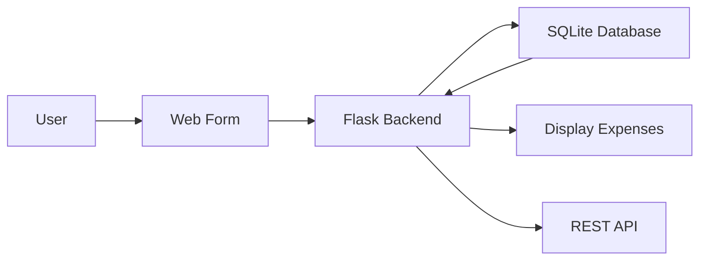

# 💰 Flask Expense Tracker

<div align="center">


**Simple Personal Expense Tracking Web Application**

[]()
[](https://github.com/samalarakshithbabu/flask-expense-tracker/issues)

</div>

---

## 🚀 Executive Summary

A **simple and functional expense tracker web application** built with Flask and SQLite. Helps users manage personal expenses by adding, storing, and viewing records through a clean web interface and RESTful APIs.

### What It Does



---

## ✨ Key Features

| Feature | Description |
|---------|-------------|
| **Add Expenses** | Date, category, description, and amount |
| **View Expenses** | Display all stored records |
| **REST API** | JSON-based POST (add) and GET (fetch) |
| **SQLite Persistence** | Auto-created local database |
| **Jinja2 Templates** | Clean HTML form interface |

---

## 🛠️ Technology Stack

| Component | Technology | Purpose |
|-----------|------------|---------|
| **Backend** | Python + Flask | Web framework |
| **Database** | SQLite | Local persistence |
| **Frontend** | HTML + Jinja2 | Templating |
| **API** | JSON REST | Programmatic access |

---

## 📁 Project Structure

```
flask-expense-tracker/
├── app.py              # Main Flask application
├── expenses.db         # SQLite database (auto-created)
├── templates/
│   └── index.html      # HTML form for user input
├── static/             # Optional CSS, images, JS
└── README.md           # This file
```

---

## 🛠️ Installation

### Prerequisites
- Python 3.8+
- pip

### Setup
```bash
git clone https://github.com/samalarakshithbabu/flask-expense-tracker.git
cd flask-expense-tracker
pip install flask
python app.py
# Opens at http://localhost:5000
```

---

## 📡 API Endpoints

| Method | Endpoint | Description |
|--------|----------|-------------|
| GET | `/` | View all expenses |
| POST | `/add` | Add new expense (JSON) |
| GET | `/api/expenses` | Get all expenses (JSON) |

---

## ⚠️ Limitations

| Limitation | Description |
|------------|-------------|
| **No Authentication** | Anyone can access |
| **No Edit/Delete** | Expenses cannot be modified |
| **Single User** | No multi-tenant support |

---

## 📄 License

This project is licensed under the MIT License.

---

## 👨‍💻 Author

**SAMALA RAKSHITH BABU**

- 📧 Email: samalarakshithbabu7@gmail.com
- 💼 LinkedIn: [samala-rakshith-babu](https://www.linkedin.com/in/samala-rakshith-babu/)
- 🐙 GitHub: [samalarakshithbabu](https://github.com/samalarakshithbabu)